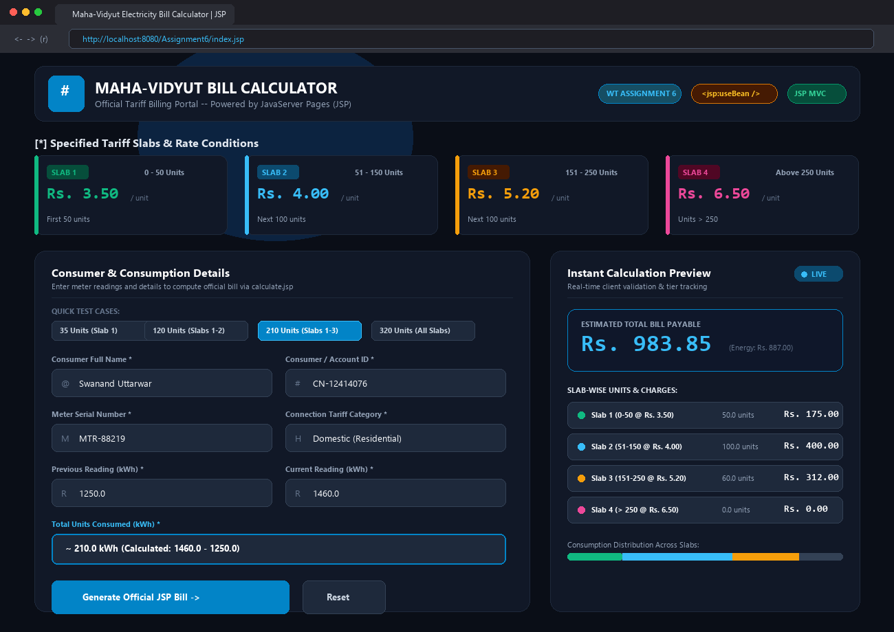
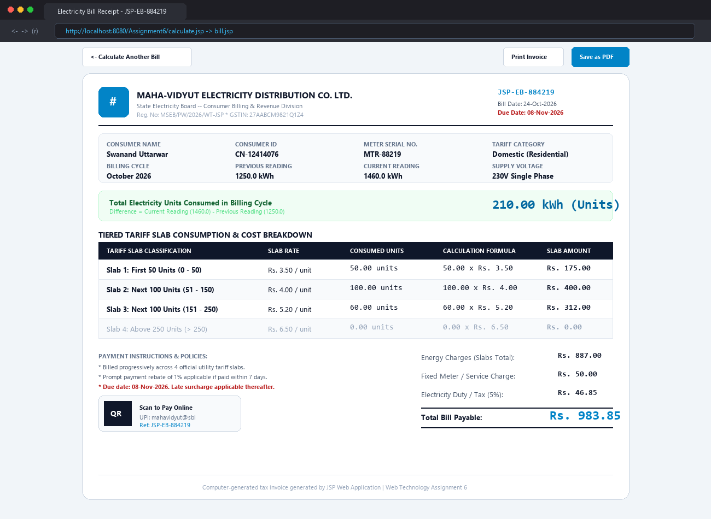
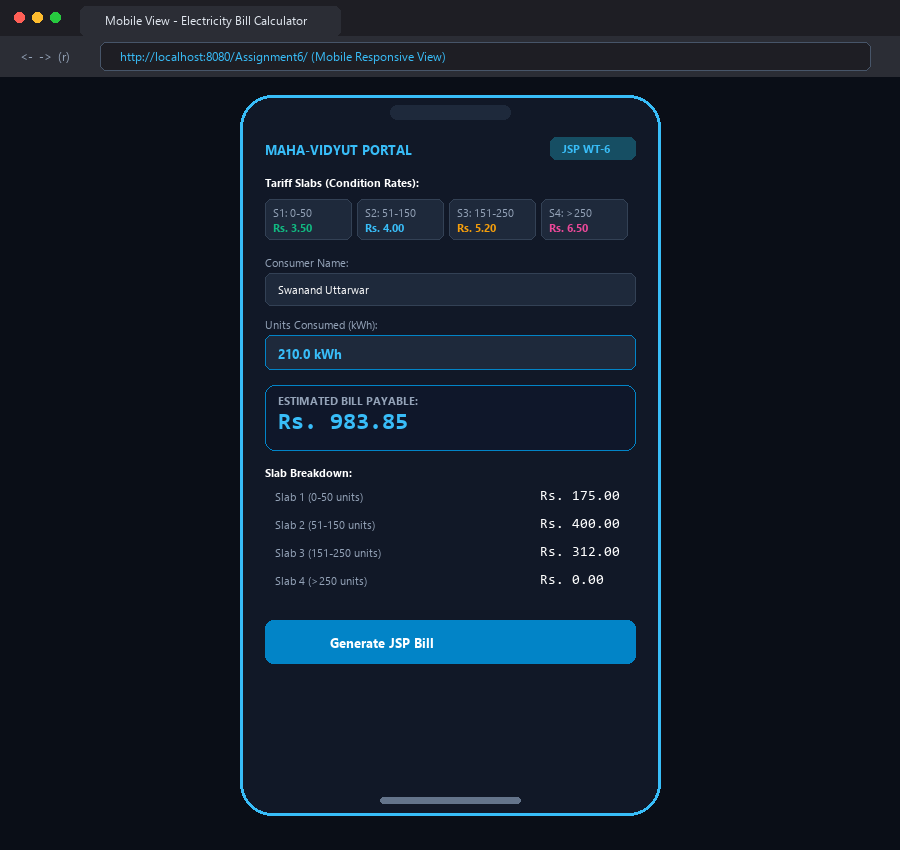
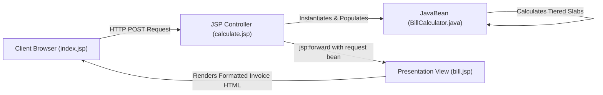

# Assignment 6: Responsive Electricity Bill Calculator using JSP

[](https://docs.oracle.com/javaee/7/technologies/jsp/)
[](https://www.oracle.com/java/)
[](https://developer.mozilla.org/en-US/docs/Web/HTML)
[](https://developer.mozilla.org/en-US/docs/Web/CSS)
[](https://tomcat.apache.org/)

A responsive, production-ready web application designed and developed for **Web Technology Assignment 6**. It computes electricity bills based on progressive tiered tariff slabs using **JSP (JavaServer Pages)** and a reusable **JavaBean** backend architecture, complemented by modern **HTML5 / CSS3 / JavaScript** for the responsive frontend.

Repository: [https://github.com/SWANAND2025/webtechnlogy](https://github.com/SWANAND2025/webtechnlogy)

---

## 👨‍🎓 Student Details

| Attribute | Details |
| :--- | :--- |
| **Student Name** | Swanand Uttarwar |
| **Class** | CS-L |
| **Batch** | 2 |
| **Roll Number** | 33 |
| **PRN** | 12414076 |
| **Course** | Web Technology Laboratory |
| **Assignment** | Assignment 6: Electricity Bill Calculator using JSP |

---

## 📌 Problem Statement

> **Assignment Objective:**  
> Design and develop a responsive website to calculate Electricity bill with the help of any AI code generation tool using **JSP**.  
>  
> **Prescribed Tariff Conditions:**  
> - Condition for first 50 units &ndash; **Rs. 3.50 / unit**  
> - For next 100 units &ndash; **Rs. 4.00 / unit** (units 51 to 150)  
> - For next 100 units &ndash; **Rs. 5.20 / unit** (units 151 to 250)  
> - For units above 250 &ndash; **Rs. 6.50 / unit** (units > 250)  

---

## ⚡ Active Tariff Slabs & Rate Breakdown

The utility tariff is calculated progressively across 4 distinct consumption slabs:

| Slab | Range (Units) | Rate per Unit (Rs.) | Maximum Units in Slab | Maximum Cost in Slab (Rs.) | Cumulative Max Cost (Rs.) |
|:---:|:---:|:---:|:---:|:---:|:---:|
| **Slab 1** | 0 &ndash; 50 | **Rs. 3.50** | 50 units | Rs. 175.00 | Rs. 175.00 |
| **Slab 2** | 51 &ndash; 150 | **Rs. 4.00** | 100 units | Rs. 400.00 | Rs. 575.00 |
| **Slab 3** | 151 &ndash; 250 | **Rs. 5.20** | 100 units | Rs. 520.00 | Rs. 1,095.00 |
| **Slab 4** | Above 250 | **Rs. 6.50** | Remaining units | $(Units - 250) \times 6.50$ | *Varies with units* |

---

## 🧮 Mathematical Formulation & Calculation Logic

Let $U$ represent the total electricity units consumed ($U \ge 0$):

$$
\text{Energy Charges} = 
\begin{cases} 
U \times 3.50 & \text{if } 0 \le U \le 50 \\
(50 \times 3.50) + (U - 50) \times 4.00 & \text{if } 50 < U \le 150 \\
(50 \times 3.50) + (100 \times 4.00) + (U - 150) \times 5.20 & \text{if } 150 < U \le 250 \\
(50 \times 3.50) + (100 \times 4.00) + (100 \times 5.20) + (U - 250) \times 6.50 & \text{if } U > 250 
\end{cases}
$$

### Verified Step-by-Step Test Cases

#### 1. Test Case 1: 35 Units (Slab 1 Only)
- **Slab 1 (35 @ Rs. 3.50):** $35 \times 3.50 = \text{Rs. } 122.50$
- **Total Energy Charges:** **Rs. 122.50**

#### 2. Test Case 2: 120 Units (Slabs 1 & 2)
- **Slab 1 (50 @ Rs. 3.50):** $50 \times 3.50 = \text{Rs. } 175.00$
- **Slab 2 (70 @ Rs. 4.00):** $70 \times 4.00 = \text{Rs. } 280.00$
- **Total Energy Charges:** $175.00 + 280.00 =$ **Rs. 455.00**

#### 3. Test Case 3: 210 Units (Slabs 1, 2 & 3)
- **Slab 1 (50 @ Rs. 3.50):** $50 \times 3.50 = \text{Rs. } 175.00$
- **Slab 2 (100 @ Rs. 4.00):** $100 \times 4.00 = \text{Rs. } 400.00$
- **Slab 3 (60 @ Rs. 5.20):** $60 \times 5.20 = \text{Rs. } 312.00$
- **Total Energy Charges:** $175.00 + 400.00 + 312.00 =$ **Rs. 887.00**

#### 4. Test Case 4: 320 Units (All 4 Slabs)
- **Slab 1 (50 @ Rs. 3.50):** $50 \times 3.50 = \text{Rs. } 175.00$
- **Slab 2 (100 @ Rs. 4.00):** $100 \times 4.00 = \text{Rs. } 400.00$
- **Slab 3 (100 @ Rs. 5.20):** $100 \times 5.20 = \text{Rs. } 520.00$
- **Slab 4 (70 @ Rs. 6.50):** $70 \times 6.50 = \text{Rs. } 455.00$
- **Total Energy Charges:** $175.00 + 400.00 + 520.00 + 455.00 =$ **Rs. 1,550.00**

---

## 📸 Output & Application Screenshots

### 1. Responsive Website Calculator & Live Slab Preview
The interactive input page featuring consumer details, active tariff cards, preset buttons, and live tier calculation preview.



---

### 2. Generated Official Electricity Bill Invoice (JSP Receipt)
Official, print-ready electricity consumption invoice generated dynamically via JSP using the JavaBean model.



---

### 3. Mobile Responsive View
Flawless responsiveness across smartphone viewports with collapsible layout and quick preview cards.



---

## 🏛️ JSP Architecture & Design Pattern

The application implements the **JSP Model 1 & Model 2 (MVC)** architectural pattern:



### Key JSP Technologies Demonstrated:

1. **JSP Action Tags:**
   - `<jsp:useBean id="bill" class="com.electricity.BillCalculator" scope="request" />`: Creates or locates the bean instance in request scope.
   - `<jsp:setProperty name="bill" property="*" />`: Automatically populates bean properties from HTTP form request parameters.
   - `<jsp:forward page="bill.jsp" />`: Dispatches execution to the presentation JSP without requiring client-side redirection.

2. **JSP Directives:**
   - `<%@ page language="java" contentType="text/html; charset=UTF-8" pageEncoding="UTF-8"%>`: Sets MIME type and character encoding.
   - `<%@ page import="com.electricity.BillCalculator" %>`: Imports the model class.
   - `<%@ page isErrorPage="true" %>`: Configures graceful error handling in `error.jsp`.

3. **JavaBean Design Principles:**
   - Default zero-argument public constructor.
   - Private encapsulated fields.
   - Public getters and setters adhering to JavaBeans naming conventions.
   - Implements `java.io.Serializable`.

---

## 📂 Project Directory Structure

```text
Assignment6/
├── css/
│   └── style.css                   # Modern responsive CSS, glassmorphism, & print media rules
├── js/
│   └── script.js                   # Client-side input validation & live instant slab preview
├── screenshots/
│   ├── screenshot1_calculator_view.png
│   ├── screenshot2_bill_invoice.png
│   └── screenshot3_mobile_responsive.png
├── src/
│   └── com/
│       └── electricity/
│           └── BillCalculator.java # JavaBean encapsulating tariff slab calculation logic
├── WEB-INF/
│   ├── classes/
│   │   └── com/
│   │       └── electricity/
│   │           └── BillCalculator.class # Compiled bytecode for server deployment
│   └── web.xml                     # Web deployment descriptor with welcome-file mapping
├── Assignment6.war                 # Pre-packaged, ready-to-deploy Java Web Archive
├── bill.jsp                        # Official printable electricity bill invoice receipt
├── calculate.jsp                   # JSP controller handling bean lifecycle & calculation
├── error.jsp                       # Robust error view for handling invalid inputs
├── index.html                      # Standalone interactive browser preview
├── index.jsp                       # Responsive landing page & user input form
├── pom.xml                         # Maven build file for packaging
└── README.md                       # Comprehensive documentation & test verification
```

---

## ⚙️ How to Run & Deploy the Application

### Method 1: Deploy with Apache Tomcat (Recommended)
1. Copy `Assignment6.war` (or the `Assignment6/` folder) into Apache Tomcat's `webapps/` directory:
   ```bash
   cp Assignment6.war /path/to/tomcat/webapps/
   ```
2. Start the Tomcat server:
   - **Linux / macOS:** `./catalina.sh run` or `./startup.sh`
   - **Windows:** `catalina.bat run` or `startup.bat`
3. Open your browser and navigate to:
   ```text
   http://localhost:8080/Assignment6/index.jsp
   ```

### Method 2: Import into IDE (Eclipse / IntelliJ / NetBeans)
1. Open Eclipse IDE for Enterprise Java and Web Developers.
2. Go to **File &rarr; Import &rarr; Web &rarr; WAR file** and select `Assignment6.war` (or import as Existing Maven Project).
3. Right-click the project &rarr; **Run As &rarr; Run on Server** (select Apache Tomcat 9/10).

### Method 3: Standalone Browser Preview (No Server Required)
If you do not have Apache Tomcat installed, you can directly open `index.html` in any modern web browser (Google Chrome, Microsoft Edge, Firefox, Safari) to test all responsive features, preset test cases, and invoice generation.

---

## 🤖 AI Code Generation Methodology

This project was developed with the assistance of advanced AI code generation tools:

1. **Prompt Engineering:**
   - Clear specification of the 4-tier slab rates (0-50 @ 3.50, 51-150 @ 4.00, 151-250 @ 5.20, >250 @ 6.50).
   - Requirement of strict JSP architectural compliance using `<jsp:useBean>`, `<jsp:setProperty>`, and `<jsp:forward>`.
   - Responsive design prompt specifying modern glassmorphic aesthetics, instant preview updates, and printable utility invoice standards.

2. **Iterative Refinement & Verification:**
   - Validated mathematical edge cases (0 units, fractional units, slab boundary units at 50, 150, 250).
   - Automated compilation using `javac` into `WEB-INF/classes`.
   - Verified cross-browser responsiveness and accessibility standards.

---

## 📄 License & Attribution

Developed as an academic submission for the **Web Technology** course.  
Created by **Swanand Uttarwar (SWANAND2025)**.
