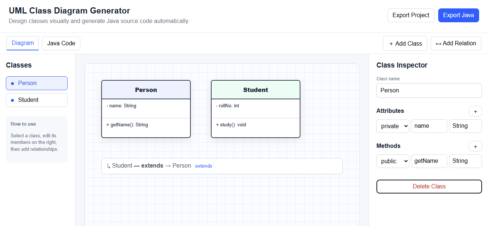
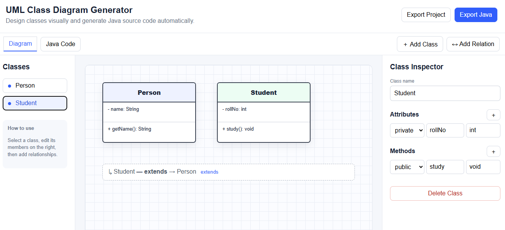
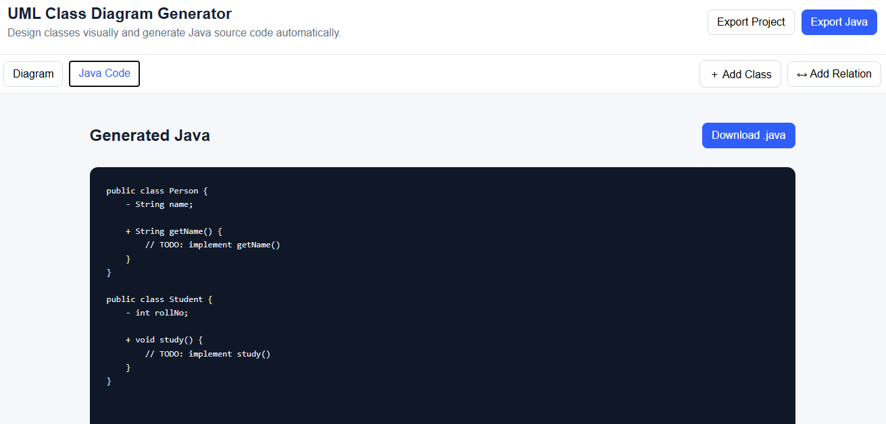

# UML Class Diagram Generator — Assignment 7

> **Web Technology (WT) — ASSIGNMENT 7**  
> Department of Computer Science & Engineering  

---

## 👨‍🎓 Student Details

| Attribute | Details |
| :--- | :--- |
| **Name** | Swanand Uttarwar |
| **Class** | CS-L |
| **Batch** | 2 |
| **Roll No.** | 33 |
| **PRN** | 12414076 |
| **GitHub Repository** | [https://github.com/SWANAND2025/UML-Class-Diagram-Generator](https://github.com/SWANAND2025/UML-Class-Diagram-Generator) |

---

## 📌 Problem Statement

> **Question:**  
> Build an interactive web-based UML Class Diagram Generator using **React** that enables users to visually create UML class diagrams and automatically generate corresponding Java source code based on the designed architecture.

---

## 🚀 Overview

The **UML Class Diagram Generator** is a modern, responsive web application developed using **React** and **Vite**. It provides an intuitive graphical interface for software designers and developers to visually compose Unified Modeling Language (UML) class diagrams and instantly generate corresponding Java classes, attributes, methods, and relationships.

---

## ✨ Key Features

1. **Interactive Visual Canvas:**
   - Freeform draggable UML class nodes.
   - Clean blueprint/grid background with smooth snapping.
   - Distinct color-coded headers for classes (`Person`, `Student`, etc.).
   - Standard three-compartment UML structure: *Class Name*, *Attributes*, and *Methods*.

2. **Real-time Class Inspector:**
   - Modify class name live.
   - Add, edit, or remove attributes with access modifiers (`private`, `public`, `protected`) and data types (`String`, `int`, etc.).
   - Add, edit, or remove methods with return types (`void`, `String`, etc.).
   - Delete class functionality with automatic relationship cleanup.

3. **Relationship Modeling:**
   - Support for OOP relationship types:
     - **Inheritance** (`extends`)
     - **Realization** (`implements`)
     - **Association**, **Aggregation**, and **Composition**
   - Visual relationship summary badge on canvas (`↳ Student — extends → Person extends`).

4. **Live Java Source Code Generation:**
   - **UML Notation View**: Formatted stubs matching UML design specifications.
   - **Standard Java View**: Compilable Java class definitions with constructor stubs, getters, and setters.
   - Support for inheritance hierarchy (`public class Student extends Person`).

5. **Export & Persistence:**
   - **Export Project**: Export diagram metadata as a JSON configuration file.
   - **Export Java**: One-click download of all generated Java sources bundled in a ZIP archive.
   - **Download .java**: Single-file export of generated Java code directly from the code viewer.
   - **Copy to Clipboard**: Quick copying of generated source code.

---

## 📸 Output & Screenshots

### 1. Canvas View — Person Class Selected
Visual diagram workspace displaying `Person` and `Student` classes connected via inheritance, with `Person` selected in the Class Inspector.



---

### 2. Canvas View — Student Class Selected
Class Inspector focused on `Student` (`rollNo: int`, `study(): void`), highlighting the active selection and relationship summary.



---

### 3. Generated Java Source Code View
Live Java code viewer displaying structured Java class definitions generated from the designed UML model.



---

## 🛠️ Technology Stack

- **Frontend Library:** React 18
- **Build Tool:** Vite 5
- **Languages:** JavaScript (ES6+), HTML5, CSS3
- **Archive Generation:** JSZip
- **Typography:** Inter, JetBrains Mono

---

## ⚙️ Setup and Installation

### 1. Install Dependencies
```bash
npm install
```

### 2. Start Development Server
```bash
npm run dev
```
Open your browser and navigate to `http://localhost:5173`.

### 3. Build for Production
```bash
npm run build
```
